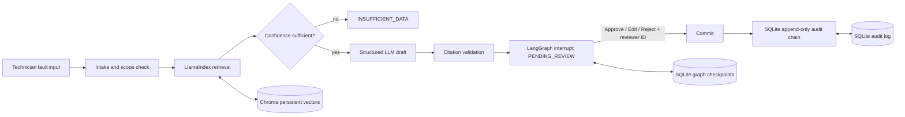

# AeroFix AI

AeroFix AI is a local, human-gated aviation maintenance decision-support MVP for
a Cessna 172 with a Lycoming O-320 engine. It retrieves locally ingested source
material, creates a cited draft, interrupts for technician review, and appends only
the human decision to a hash-chained audit log.

It is not a maintenance manual, a maintenance-record system of record, or an
authorization to return an aircraft to service.

> **New here?** Follow **[SETUP.md](SETUP.md)** — the full step-by-step command
> guide (venv → install → ingest → run → test) with expected output for every
> step and a troubleshooting table.

## Setup

Requires Python 3.11 (the project metadata intentionally pins 3.11 through 3.12).

```powershell
cd aerofix
py -3.11 -m venv .venv
.\.venv\Scripts\Activate.ps1
pip install -r requirements.txt
Copy-Item .env.example .env
```

Embeddings default to the local HuggingFace model `BAAI/bge-small-en-v1.5`, so
indexing and querying need no API key. The drafting LLM defaults to `openai`
(`gpt-4o`); if the matching credential (`OPENAI_API_KEY` / `ANTHROPIC_API_KEY`
in the environment or `.env`) is not set, the app logs a notice in the terminal
and falls back to the local MockLLM, which drafts only verbatim extractive text
from the retrieved chunks. To use Anthropic, set `AEROFIX_LLM_PROVIDER=anthropic`
and a Claude model identifier.

For a no-network plumbing demo only, set both `AEROFIX_LLM_PROVIDER=mock` and
`AEROFIX_EMBEDDING_PROVIDER=mock`. Mock mode is never suitable for maintenance
decisions.

## Ingest Sources

Put current, text-based PDFs under `data/raw/`. See [data/raw/README.md](data/raw/README.md)
for public source categories. The ingester extracts every page with PyMuPDF, detects
section-like headings, chunks at paragraph boundaries with overlap, and preserves
document, source, page, section, and stable chunk ID metadata.

```powershell
python ingest.py
```

Run the non-approved local plumbing fixture only with:

```powershell
python ingest.py --include-sample
```

Ingestion is idempotent: rerunning the same document produces zero new chunks.

## Run The Review Desk

```powershell
streamlit run app.py
```

Enter a symptom or select an example. The review desk shows editable cited steps on
the left and the retrieved, page-addressable evidence on the right. A reviewer name
or ID is mandatory for Approve, Edit & approve, or Reject. Existing interrupted
workflows can be restored by thread ID from the sidebar.

### Ops Center UI Notes

- The header carries a live UTC clock plus the status pills (manuals indexed and
  the current phase).
- The background is a normal world map: equirectangular land polygons with a
  faint coastline and latitude/longitude graticule, drawn dark and dim behind
  the content. Land geometry comes from **Natural Earth 1:110m physical vectors**
  (public domain, no attribution required), simplified to 0.3° and bundled
  locally at `ui/assets/world-land.json`; `scripts/build_world_map.py` embeds it
  into `ui/sky.html`. There is no CDN, no map API and no runtime network call.
  The static layer (ocean, grid, land, coastlines, graticule) is rendered into
  an offscreen canvas and repainted only on resize.
- The animated background sky is decorative only. Its canvas is drawn in the page
  behind every card at `z-index: -1` with pointer events disabled, so aircraft never
  overlap headline or field text at a readable opacity and are never clickable.
  To jump to a grounded aircraft's symptom, use the **AOG board** buttons in the
  hero card; they fill the fault box with the whole sentence.
- The sidebar **Workspace** control switches between **Ops Center** and
  **Audit Log**, **Resume a saved job** restores an interrupted workflow by its
  job ID, and **Reduce animations** freezes the background scene; switching it off
  resumes the same aircraft where they were.
- An OS-level *prefers-reduced-motion* setting slows the background to 30% speed
  without contrails instead of stopping it, and a pending review slows it to 40%.
- Append `?debug=1` to the URL for an on-canvas FPS and aircraft-position readout
  when diagnosing rendering problems.

## Evaluate And Test

The evaluation contains 17 realistic and out-of-scope scenarios. It reports
retrieval hit-rate@k, citation validity, refusal rate, and median latency.

```powershell
python -m eval.run_eval
python -m eval.run_eval --mock
python -m pytest
```

The mock report proves wiring only. It will show zero expected-document retrieval
hits until real PDFs are ingested; use the non-mock run to measure the actual corpus.

## Architecture



`aerofix.ingest.VectorBackend` is the storage boundary; `ChromaBackend` is the local
implementation and can be replaced with Pinecone or Supabase without changing the
workflow contract.

## Safety Model

- The drafting prompt is restricted to the retrieved chunks. Each generated step
  must cite chunk IDs from that exact retrieval result.
- Validation removes any step with an absent, fabricated, or empty citation set.
- Low-confidence retrieval, empty inputs, explicit out-of-scope requests, and drafts
  left with no valid cited steps become `INSUFFICIENT_DATA` and never reach review or
  commit.
- `review_gate` calls LangGraph `interrupt()` with a persistent SQLite checkpointer.
  The graph cannot reach `commit` from `draft`; its only incoming route is the gate.
- `commit` rejects any state without `PENDING_REVIEW`, a non-empty reviewer ID, and a
  valid human decision. Reject decisions are audited with their stated reason.
- Every audit record includes the previous record hash. `verify_chain()` recalculates
  the full chain and exposes the result in the Streamlit audit view.

## Known Limitations

- Retrieval quality depends entirely on the PDFs supplied, their OCR quality, and the
  configured embedding model. Scanned PDFs need OCR before ingestion.
- The sample text file is deliberately non-approved and must not be used as source
  material for maintenance.
- This MVP does not authenticate users, enforce roles, validate aircraft serial
  applicability, or integrate with a maintenance-record system.
- Provider calls, source currency, AD applicability, and every final action require
  certified technician judgment against current approved data.

